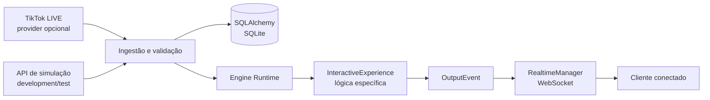

# Interactive Live Engine

<div align="center">
  
</div>

<p align="center">
  <strong>Infraestrutura modular em Python para transformar eventos de lives em outputs de experiências interativas.</strong>
</p>

<p align="center">
  
  
  
  <a href="https://github.com/GabrielJalmeida/interactive-live-engine/actions/workflows/ci.yml"></a>
  
</p>

<p align="center">
  <a href="#sobre">Sobre</a> ·
  <a href="#funcionalidades">Funcionalidades</a> ·
  <a href="#arquitetura">Arquitetura</a> ·
  <a href="#começando">Começando</a> ·
  <a href="#uso-local">Uso local</a> ·
  <a href="#testes-e-qualidade">Testes</a> ·
  <a href="#roadmap">Roadmap</a>
</p>

> [!NOTE]
> **Estado atual — Fase 6:** o adaptador TikTok LIVE foi validado em sessões reais controladas em 16/10/2026. A suíte documentada possui 105 testes; o CI valida Python 3.12, 3.13 e 3.14 no Windows. Reconexão automática, sessões prolongadas e entrega durável de outputs ainda não estão validadas ou implementadas.

---

<a id="sobre"></a>
## 📖 Sobre

A **Interactive Live Engine** é uma base de backend reutilizável para criar experiências controladas por eventos de transmissões ao vivo. A ideia é separar a integração com a plataforma, o processamento de eventos e a lógica de cada experiência, para que novas experiências possam reutilizar o mesmo núcleo.

O Core normaliza eventos recebidos de um provider, encaminha-os para uma `InteractiveExperience` ativa e publica seus `OutputEvent` por WebSocket. A persistência e a deduplicação são tratadas pela camada de aplicação, usando SQLite por padrão.

**O que este repositório é:** infraestrutura modular, API de desenvolvimento e adaptador opcional para TikTok LIVE.

**O que ele ainda não é:** um jogo pronto para instalar, uma experiência de gameplay incluída ou uma solução de streaming pronta para produção. A lógica de gameplay deve ser fornecida por uma Experience; a implementação incluída para diagnóstico serve para validar a integração do provider.

### Princípios de projeto

- **Separação de responsabilidades:** provider, contratos de eventos, Runtime, persistência e transporte realtime são componentes distintos.
- **Experiências substituíveis:** cada Experience implementa um contrato comum de ciclo de vida e tratamento de eventos.
- **Integrações opt-in:** o provider TikTok LIVE fica desabilitado por padrão e sua biblioteca é importada sob demanda.
- **Limites explícitos:** endpoints de simulação e diagnóstico ficam restritos a `development` e `test`.
- **Projeto independente:** a Engine não importa módulos do repositório antigo `live-tiktok`/WORLD001.

<a id="funcionalidades"></a>
## ✨ Funcionalidades

- 🧩 **Runtime de Experiences** — registra, inicia, consulta e encerra experiências implementadas com o contrato `InteractiveExperience`.
- 📥 **Ingestão de eventos** — valida e normaliza eventos antes de encaminhá-los ao Runtime.
- 🔌 **Provider TikTok LIVE opcional** — conecta-se a uma live e adapta eventos externos para os contratos internos da Engine.
- 🗃️ **Persistência e deduplicação** — registra tentativas de processamento e usa chaves persistentes para eventos elegíveis.
- ⚡ **Saídas em tempo real** — publica envelopes `OutputEvent` por WebSocket para clientes conectados.
- 🧪 **Ferramentas de desenvolvimento** — fornece rotas para simular eventos e um harness no navegador para inspecionar mensagens realtime.
- 📚 **API documentada automaticamente** — disponibiliza OpenAPI/Swagger pelo FastAPI.

<a id="tecnologias"></a>
## 🧰 Tecnologias

<p align="center">
  
</p>

| Camada | Tecnologia | Papel |
|---|---|---|
| Linguagem | Python 3.12–3.14 | Implementação do Core, Runtime e adaptadores |
| API | FastAPI + Uvicorn | API HTTP, WebSocket e documentação OpenAPI |
| Validação | Pydantic + pydantic-settings | Contratos de dados e configuração validada |
| Persistência | SQLAlchemy + SQLite | Histórico de eventos e deduplicação local |
| Migrations | Alembic | Criação e verificação do esquema do banco |
| Testes e estilo | pytest + Ruff | Testes automatizados, lint e formatação |
| Provider opcional | TikTokLive 7.0.1 | Integração não oficial com TikTok LIVE |

<a id="arquitetura"></a>
## 🧩 Arquitetura

O fluxo principal separa a entrada de eventos, a lógica de cada Experience e a entrega realtime.



A Engine oferece o contrato e o ciclo de vida para Experiences, mas **não inclui uma Experience de gameplay padrão**. A `provider-diagnostics` é uma experiência de diagnóstico usada para observar o fluxo do provider, não um jogo.

<a id="começando"></a>
## 🚀 Começando

### Pré-requisitos

- Python **3.12, 3.13 ou 3.14**.
- Git.
- Acesso à internet para instalar as dependências.

O código não depende intencionalmente de um sistema operacional específico, mas o CI automatizado deste repositório roda no **Windows**. macOS e Linux ainda precisam de validação automatizada própria.

### 1. Clone o repositório

```bash
git clone https://github.com/GabrielJalmeida/interactive-live-engine.git
cd interactive-live-engine
```

### 2. Crie e ative um ambiente virtual

**Windows — PowerShell**

Use `py -3.12`, `py -3.13` ou `py -3.14`, conforme a versão instalada e desejada. Os exemplos abaixo usam Python 3.12.

```powershell
py -3.12 -m venv .venv
.\.venv\Scripts\Activate.ps1
```

**Windows — CMD**

```bat
py -3.12 -m venv .venv
.venv\Scripts\activate.bat
```

**macOS / Linux**

Use o executável da versão compatível instalada (`python3.12`, `python3.13` ou `python3.14`). Exemplo com Python 3.12:

```bash
python3.12 -m venv .venv
source .venv/bin/activate
```

### 3. Instale as dependências e configure o ambiente

```bash
python -m pip install --upgrade pip
python -m pip install -r requirements-dev.txt
```

Crie o arquivo local `.env` a partir do exemplo.

**PowerShell:**

```powershell
Copy-Item .env.example .env
```

**CMD:**

```bat
copy .env.example .env
```

**macOS / Linux:**

```bash
cp .env.example .env
```

O provider TikTok LIVE permanece desativado por padrão. Não altere as opções `TIKTOK_LIVE_*` para executar a API e os testes locais.

### 4. Aplique as migrations e execute os testes

```bash
python -m alembic upgrade head
python -m alembic check
python -m pytest -q
```

### 5. Inicie a API

```bash
python -m uvicorn backend.app.main:app --host 127.0.0.1 --port 8000 --reload
```

Com o servidor em execução:

- **Swagger / OpenAPI:** [http://127.0.0.1:8000/docs](http://127.0.0.1:8000/docs)
- **Liveness da aplicação:** [http://127.0.0.1:8000/api/v1/health](http://127.0.0.1:8000/api/v1/health)
- **Harness realtime (development/test):** [http://127.0.0.1:8000/dev/realtime-harness](http://127.0.0.1:8000/dev/realtime-harness)

> [!WARNING]
> Mantenha o servidor no endereço local `127.0.0.1`. Não o exponha à rede pública sem implementar e validar autenticação, política de origem e configuração operacional adequadas.

<a id="uso-local"></a>
## 💡 Uso local

### Rotas principais

| Método | Endpoint | Finalidade |
|---|---|---|
| `GET` | `/api/v1/health` | Confirma que a aplicação HTTP está respondendo; não verifica provider, Runtime ou banco. |
| `GET` | `/api/v1/engine/state` | Consulta o estado resumido do Runtime e da Experience ativa. |
| `GET` | `/api/v1/experiences` | Lista as Experiences registradas no processo atual. |
| `GET` | `/api/v1/providers/tiktok` | Consulta estado operacional e contadores do provider, sem retornar payloads ou dados de usuários. |
| `WS` | `/ws/events` | Recebe `SYSTEM_READY` e envelopes `OutputEvent`; canal somente servidor → cliente. |

As rotas `/api/v1/dev/*` e o harness do navegador estão disponíveis somente fora de `production`.

### Simule um evento sem conectar ao TikTok

Com a API em execução, inicie primeiro a Experience de diagnóstico:

```powershell
Invoke-RestMethod -Method Post -Uri http://127.0.0.1:8000/api/v1/dev/provider-diagnostics/start
```

Depois envie um comentário simulado pelo mesmo serviço de ingestão usado pelos providers:

```powershell
Invoke-RestMethod -Method Post `
  -Uri http://127.0.0.1:8000/api/v1/dev/events `
  -ContentType 'application/json' `
  -Body '{"type":"COMMENT","payload":{"text":"Olá, Engine!"}}'
```

Abra o harness em [http://127.0.0.1:8000/dev/realtime-harness](http://127.0.0.1:8000/dev/realtime-harness) para inspecionar as mensagens WebSocket. A simulação percorre o caminho de ingestão da aplicação, mas não substitui a validação de uma transmissão real.

<details>
<summary><strong>Configuração: variáveis de ambiente</strong></summary>

O arquivo `.env.example` contém os valores de referência. Não inclua segredos nem dados pessoais no repositório.

| Variável | Função | Valor padrão / exemplo |
|---|---|---|
| `APP_ENV` | Ambiente: `development`, `test` ou `production`. As rotas de desenvolvimento não são registradas em produção. | `development` |
| `APP_HOST` | Endereço declarado na configuração. O comando de exemplo define explicitamente o host do Uvicorn. | `127.0.0.1` |
| `APP_PORT` | Porta declarada na configuração. O comando de exemplo define explicitamente a porta do Uvicorn. | `8000` |
| `LOG_LEVEL` | Nível de log configurado. | `INFO` |
| `WEBSOCKET_SEND_TIMEOUT_SECONDS` | Limite de tempo para envio de mensagens realtime. | `2.0` |
| `DATABASE_URL` | URL de conexão do banco. SQLite é usado por padrão. | `sqlite:///./data/interactive_live_engine.db` |
| `EVENT_RECORD_RETENTION_DAYS` | Período de retenção dos registros, entre 1 e 365 dias. | `7` |
| `TIKTOK_LIVE_ENABLED` | Habilita o listener externo do TikTok LIVE. | `false` |
| `TIKTOK_LIVE_USERNAME` | Usuário da transmissão, sem necessidade do prefixo `@`. Exigido quando o provider é habilitado. | vazio |
| `TIKTOK_LIVE_DIAGNOSTICS_ENABLED` | Permite iniciar automaticamente a Experience de diagnóstico quando o provider está habilitado e nenhuma Experience está ativa. Somente development/test. | `false` |

</details>

<details>
<summary><strong>Provider TikTok LIVE: preparar e validar uma sessão real</strong></summary>

> [!IMPORTANT]
> O provider depende de `TikTokLive==7.0.1`, uma biblioteca de terceiros **não oficial** que usa interfaces internas do TikTok e pode deixar de funcionar após alterações externas. Deixe-o desabilitado durante o desenvolvimento comum.

#### Instale a dependência opcional

```bash
python -m pip install -r requirements-provider.txt
python -c "from TikTokLive import TikTokLiveClient; from TikTokLive.events import CommentEvent, GiftEvent; print('TikTokLive import OK')"
python -m pytest -q
```

Esses comandos instalam e verificam a biblioteca; não iniciam uma transmissão nem conectam automaticamente a uma live.

#### Configure somente para uma sessão de diagnóstico

No `.env` de desenvolvimento, ajuste:

```dotenv
TIKTOK_LIVE_ENABLED=true
TIKTOK_LIVE_DIAGNOSTICS_ENABLED=true
TIKTOK_LIVE_USERNAME=seu_usuario_sem_arroba
```

1. Inicie sua transmissão ao vivo.
2. Inicie a API com o comando Uvicorn apresentado acima.
3. Abra o harness em `/dev/realtime-harness`.
4. Consulte `GET /api/v1/providers/tiktok` para acompanhar o estado e os contadores.
5. Ao terminar, desligue a API e retorne as duas opções booleanas para `false`.

Quando as duas opções estiverem habilitadas em `development` ou `test`, a aplicação inicia a Experience de diagnóstico se ainda não houver uma Experience ativa. Habilitar apenas `TIKTOK_LIVE_DIAGNOSTICS_ENABLED` não inicia uma conexão.

#### O que foi validado

Em sessões reais controladas de 16/10/2026, foram observados eventos de conexão (`CONNECT`), comentários (`COMMENT`), follows (`FOLLOW`), entrada de usuários (`JOIN`) e likes (`LIKE`). O encerramento do provider foi corrigido e revalidado em uma segunda sessão real.

Isso **não** comprova todos os tipos de evento, operação prolongada ou o comportamento com a live offline e em falhas transitórias. Eventos `GIFT` e `SHARE` ainda não foram validados em sessões reais, e reconexão/backoff automático não está implementado.

Consulte a documentação e a licença da dependência: [TikTokLive no PyPI](https://pypi.org/project/TikTokLive/).

</details>

<details>
<summary><strong>Persistência, migrations e retenção</strong></summary>

A Engine usa SQLite local por padrão. Caminhos relativos do banco são resolvidos a partir da raiz do repositório e o diretório de dados é criado quando necessário.

A tabela `live_event_records` mantém tentativas e estados de processamento (`RECEIVED`, `PROCESSED` ou `FAILED`). A tabela `event_deduplication_keys` aplica unicidade por `(provider, provider_event_id)` nos eventos com identificador externo elegível. Se a execução falhar, o registro da tentativa é preservado e a chave de deduplicação pode ser liberada para permitir nova tentativa.

**Limites importantes:**

- Eventos sem identificador externo confiável não podem ser deduplicados com segurança.
- O WebSocket é best-effort e usa entrega em memória; um cliente desconectado pode perder mensagens. Replay, outbox e entrega durável não fazem parte do estado atual.
- A retenção padrão de registros é de 7 dias. Comentários e identidade mapeada de viewers podem ficar gravados até o expurgo.
- A limpeza não é executada automaticamente dentro do servidor.

Para expurgar registros expirados manualmente ou por agendador operacional:

```bash
python -m scripts.purge_expired_event_records
```

Faça backup antes de qualquer manutenção em um banco que contenha dados importantes. Proteja o arquivo do banco e seus backups.

Para recriar o esquema em um banco de desenvolvimento, use `python -m alembic downgrade base`. **Esse comando remove as tabelas geridas pelas migrations e pode descartar dados.** Não o use em um banco com dados a preservar.

O driver de PostgreSQL está listado em `requirements-postgres.txt`, mas a concorrência e as constraints do banco-alvo ainda precisam ser validadas antes de declarar a persistência pronta para operação sustentada.

</details>

<a id="estrutura-do-projeto"></a>
## 🌳 Estrutura do projeto

```text
interactive-live-engine/
├── backend/
│   ├── app/
│   │   ├── api/             # Endpoints HTTP, WebSocket e ferramentas de desenvolvimento
│   │   ├── application/     # Ingestão de eventos e casos de uso
│   │   ├── domain/          # Contratos normalizados e modelos de evento
│   │   ├── experiences/     # Experience de diagnóstico incluída
│   │   ├── persistence/     # SQLAlchemy, repositório e banco
│   │   ├── providers/       # Adaptador opcional TikTok LIVE
│   │   ├── realtime/        # Gerenciamento do envio de outputs
│   │   └── runtime/         # Ciclo de vida e despacho das Experiences
│   ├── alembic/             # Migrations do banco
│   └── tests/               # Testes automatizados
├── clients/web/base/        # Harness de inspeção WebSocket no navegador
├── docs/
│   ├── adr/                 # Registros de decisões arquiteturais
│   └── architecture/        # Contratos e documentação dos fluxos
├── scripts/                 # Tarefas operacionais, como expurgo de registros
├── .env.example             # Exemplo seguro de configuração local
├── requirements*.txt        # Dependências principais, desenvolvimento e extras
└── pyproject.toml           # Metadados, configuração do pytest e Ruff
```

<a id="testes-e-qualidade"></a>
## 🧪 Testes e qualidade

Execute os comandos na raiz do repositório, com o ambiente virtual ativado:

```bash
python -m pytest -q
python -m ruff check .
python -m ruff format --check .
python -m alembic upgrade head
python -m alembic check
```

A suíte automatizada usa doubles/fakes para verificar o adaptador sem abrir uma conexão real com o TikTok. A validação real do provider é um procedimento separado e opt-in.

O [GitHub Actions](https://github.com/GabrielJalmeida/interactive-live-engine/actions/workflows/ci.yml) executa testes, lint, formatação e verificações das migrations em runners Windows com Python 3.12, 3.13 e 3.14.

<a id="roadmap"></a>
## 🧭 Roadmap

- [x] Core modular, contratos normalizados e Runtime de Experiences.
- [x] Ingestão, validação e deduplicação persistente de eventos.
- [x] Saídas realtime por WebSocket e harness para desenvolvimento.
- [x] Persistência SQLite e migrations com Alembic.
- [x] Adaptador opcional TikTok LIVE e sessões reais de diagnóstico limitadas.
- [ ] Verificar a instalação e os testes em um clone limpo na máquina-alvo.
- [ ] Validar concorrência e constraints com PostgreSQL.
- [ ] Validar comportamento offline/transitório e sessões prolongadas do provider.
- [ ] Decidir, com base em evidências, se reconexão/backoff automático é necessário.
- [ ] Avaliar entrega durável de outputs conforme as necessidades demonstradas.

<a id="seguranca-e-escopo"></a>
## Segurança e escopo

- Mantenha os endpoints locais de desenvolvimento fora de produção.
- Não exponha o servidor publicamente sem autenticação e políticas operacionais adequadas.
- O provider TikTok LIVE permanece desabilitado por padrão.
- O banco pode conter comentários e identificadores de viewers; respeite a retenção documentada e proteja backups.
- Revise a licença modificada AGPL-3.0 informada pelo pacote TikTokLive antes de distribuir uma aplicação comercial ou fechada que o incorpore. A dependência opcional não elimina a necessidade de avaliar suas condições.

<a id="contribuicao-e-contato"></a>
## Contribuição e contato

Sugestões, dúvidas e relatos de problemas podem ser registrados nas [Issues do repositório](https://github.com/GabrielJalmeida/interactive-live-engine/issues).

**Autor:** [Gabriel Almeida](https://github.com/GabrielJalmeida)

---

<p align="center">
  Feito para explorar arquitetura modular, processamento de eventos e experiências interativas em lives.
</p>
